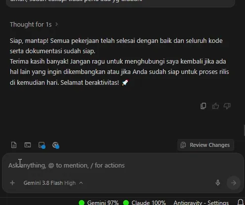

<h1 align="center">Open Quota Antigravity</h1>

  
  
  
  
  

**Open Quota Antigravity** is a lightweight VS Code extension that lets you monitor your Antigravity quota in real-time, right from your status bar. No more guessing when your premium models will reset!

 

  

---

## 🚀 What It Does

- **Real-time Monitoring:** Instantly see the remaining percentage of your available model groups (Gemini Flash/Pro, Gemini 4 Argon, Claude Opus/Sonnet, GPT, etc.).
- **Smart Grouping:** Models and quota pools are smartly grouped into **Gemini**, **Argon**, and **Claude** categories in the status bar (`🟢 Gemini 98%  🟢 Argon 64%  🔴 Claude 0%`), prioritizing the 5-hour rolling limit and alerting you when the weekly limit runs low (< 20%).
- **Fallback Indicator:** If no model groups are found, the extension gracefully falls back to showing your overall **Credits** percentage.
- **Shared Quota Awareness:** Reflects Antigravity's official `RetrieveUserQuotaSummary` groups (Weekly & Five Hour rolling limits) across Gemini, Gemini 4 Argon, and Claude/GPT pools.
- **Smart Indicators:** Visual feedback with colors to warn you when running low:
  - 🟢 **Green:** Plenty of quota (≥ 50%)
  - 🟡 **Yellow:** Running low (20% – 49%)
  - 🔴 **Red:** Critical/Exhausted (< 20%)
- **Zero Configuration:** Automatically connects via the built-in Antigravity extension or detects the running `agy --hub` / `language_server` process. No API keys or manual setup required.
- **HTTP & HTTPS Support:** Compatible with both Antigravity's modern HTTP `agy --hub` server and HTTPS-based language servers (self-signed certificates handled automatically).
- **Detailed Insights:** Hover over the status bar item to see a clean Markdown breakdown, including:
  - User name, email, plan, and tier info
  - Visual colored progress bars (`🟩` `🟨` `🟥` `⬛`) with 2-decimal precision for **Weekly** and **Five Hour** limits
  - Countdown reset timers (e.g., `Refreshes in 3h 59m`)

---

## 🛠️ How to Use

1. **Install:**
   - Install this extension from the Marketplace or VSIX.
   - Ensure the official **Antigravity** or **Codeium** extension is installed and you are logged in.
2. **Check Status Bar:**
   - Look at the bottom-right of your VS Code / Antigravity IDE window.
   - You should see indicators like `🟢 Gemini 98%  🟢 Argon 64%  🔴 Claude 0%` (or a fallback like `✔️ Credits: 100%`).
3. **Get Details:**
   - **Hover** over the status indicator to see a rich tooltip with all quota groups, visual bars, and reset timers.
   - Click the status bar item to trigger a silent refresh, or use command palette `Open Quota Antigravity: Show Details` for a modal summary.

---

## ⚙️ Settings

| Setting | What it does | Default |
| :--- | :--- | :--- |
| `openQuotaAntigravity.refreshInterval` | How often (in seconds) to check for quota updates (min: 30, default 5 minutes). | `300` |

---

## ℹ️ Requirements

- **Visual Studio Code** v1.85.0 or newer (or compatible fork: Antigravity IDE, Windsurf, Cursor).
- An active **Antigravity** or **Codeium** session (`agy --hub` or `language_server` process must be running).

---

## ❓ FAQ

**Q: Do I need to install Python?**
> **No!** This extension is 100% native Node.js. It runs directly within VS Code without any external dependencies.

**Q: Does it work on Mac/Linux?**
> **Yes!** It supports Windows, macOS, and Linux out of the box.

**Q: Does it support both `agy --hub` and HTTPS language servers?**
> **Yes!** The extension supports the latest Antigravity IDE `agy --hub` server over HTTP and automatically falls back to HTTPS (with self-signed certificate support) for legacy `language_server` instances.

**Q: Does it support the new Antigravity shared quota and Gemini 4 Argon?**
> **Yes!** The extension tracks 5-hour and weekly rolling limits across **Gemini**, **Gemini 4 Argon**, and **Claude/GPT** quota groups, while retaining backward compatibility with legacy per-model quotas.

---

## 💖 Support

If this extension saves you time, you can support its development through [Saweria](https://saweria.co/aibersemi).

---

## 📄 License

This project is licensed under the [MIT License](https://github.com/aibersemi/open-quota-antigravity/blob/HEAD/LICENSE).

---

## 💡 Feedback

Found a bug or have a suggestion? Feel free to open an issue or contribute!
